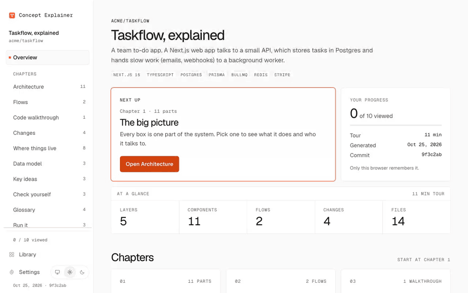

<p align="center">
  
</p>

<p align="center">
  <b>Explain anything technical as a guided, interactive picture.</b><br>
  An agent skill that turns a repo, a PR, a proposal, a migration, an incident or a concept into one page: diagrams first, ideas broken into parts, every claim cited.
</p>

<p align="center">
  <a href="https://github.com/Cyvid7-Darus10/concept-explainer/actions/workflows/ci.yml"></a>
  <a href="LICENSE"></a>
  
  
</p>

<p align="center">
  <a href="https://cyvid7-darus10.github.io/concept-explainer/examples/taskflow.html"><b>Live demo</b></a>
  &nbsp;·&nbsp;
  <a href="#quick-start"><b>Quick start</b></a>
  &nbsp;·&nbsp;
  <a href="#docs"><b>Docs</b></a>
</p>

<p align="center">
  <a href="https://cyvid7-darus10.github.io/concept-explainer/examples/taskflow.html"></a>
</p>

## Why

Twenty merge requests land in a day, many from coding agents. An RFC proposes a new queue. Last night's outage has a ten page post-mortem. Nobody holds the whole picture, and reading every diff and doc does not scale.

Concept Explainer has your agent do the reading, then **teach** the result: one idea at a time, a picture for each idea, and every claim linked to a real line of code or a real source.

## Quick start

```sh
git clone https://github.com/Cyvid7-Darus10/concept-explainer ~/side/concept-explainer
node ~/side/concept-explainer/bin/concept-explainer.mjs install
```

Then ask your agent:

> Explain PR 512 for a reviewer.
>
> Explain how idempotency keys work, with diagrams.
>
> Explain this repo for a new engineer. Trace sign in and checkout end to end.

The agent follows [`SKILL.md`](SKILL.md): it works out the type, [shows the time and cost](docs/cost.md), waits for your go-ahead, builds the page and files it in your [library](docs/library.md). Any agent that can read a skill file and run Node can use it.

No agent? Use the CLI directly with `npx github:Cyvid7-Darus10/concept-explainer`. See [commands](docs/commands.md).

## What it can explain

| Type | What you see | Example |
|---|---|---|
| `repo` | The architecture map, step-through request flows, the data model, what changed and why | [Taskflow](https://cyvid7-darus10.github.io/concept-explainer/examples/taskflow.html) |
| `pr` | The problem, the diff file by file, the parts that move on the map, risks, rollout | [Cursor paging](https://cyvid7-darus10.github.io/concept-explainer/examples/pr-cursor-paging.html) |
| `change` | What one commit or range moved and why, and what could break | |
| `proposal` | Problem and goals, options side by side with the chosen one marked, rollout | [Live updates](https://cyvid7-darus10.github.io/concept-explainer/examples/proposal-live-updates.html) |
| `migration` | Before and after flows, the steps to get there, risks during the move | |
| `incident` | A timeline from the record, how the failure flowed, causes, follow ups | |
| `concept` | The idea in 2 to 6 parts, a diagram for each, a worked case, a quiz | [Idempotency keys](https://cyvid7-darus10.github.io/concept-explainer/examples/concept-idempotency-keys.html) |

Each type's chapters: [`references/types.md`](references/types.md).

## Highlights

- **Pictures first.** Maps, sequence flows you step through, nine clickable diagram kinds and code walkthroughs. [More](docs/features.md)
- **Every claim cited.** Code claims link to `file:line`, and the build checks the files exist. [More](docs/consistency.md)
- **Cost shown up front.** An estimate per model before any work, or a budget so it never asks. [More](docs/cost.md)
- **One searchable library** of every explainer you build, offline, with an optional Dock app. [More](docs/library.md)
- **Same look every time.** Agents write data only; the design is fixed and tested. [More](docs/consistency.md)
- **Local and safe.** Zero npm dependencies, no network requests from pages, and repo content is never followed as instructions. [More](SECURITY.md)

## Docs

| Doc | Read it for |
|---|---|
| [What a page looks like](docs/features.md) | Diagrams, walkthroughs, links to any view, styles and Settings |
| [Commands](docs/commands.md) | Every CLI command and what `install` changes |
| [The library](docs/library.md) | Search, serve, the Dock app, sharing bundles |
| [Cost and estimates](docs/cost.md) | Price per run and model |
| [Consistency](docs/consistency.md) | The data contract and the tests that guard the look |
| [Security](SECURITY.md) | Design notes and how to report a vulnerability |
| [`references/`](references/) | The agent-facing specs: data schema, types, visuals, explaining method |

## Coming next

- **It learns what to explain better:** readers mark sections "Explain more" or "Too basic", and the next update deepens what they asked about (branch `feat/learning-loop`).

> Concept Explainer was called Repo Explainer. The `repo-explainer` command is still an alias and prints a note, and your library moves from `~/.repo-explainer` to `~/.concept-explainer` on the first run, without deleting anything.

## Credits

Type and greys from [Geist](https://vercel.com/geist). Lesson pacing inspired by [Brilliant](https://brilliant.org), the Playful style by [Duolingo](https://www.duolingo.com)'s design language, and explanation design by Bret Victor's [Explorable Explanations](https://worrydream.com/ExplorableExplanations/), Red Blob Games and the C4 model.

Concept Explainer is independent and not affiliated with or endorsed by Vercel, Brilliant or Duolingo. It includes none of their logos, mascots or illustrations. Geist and Geist Mono are self-hosted under the SIL Open Font License (`fonts/OFL.txt`). The icons and the mark are original.

## Contributing and license

Issues and pull requests are welcome. Read [CONTRIBUTING.md](CONTRIBUTING.md) and run `npm run check` before opening a PR.

[Apache License 2.0](LICENSE). If you use or adapt this project, keep the [NOTICE](NOTICE) file, which credits Cyrus David Pastelero, as the license requires.
