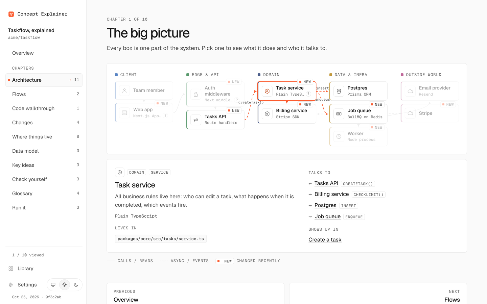
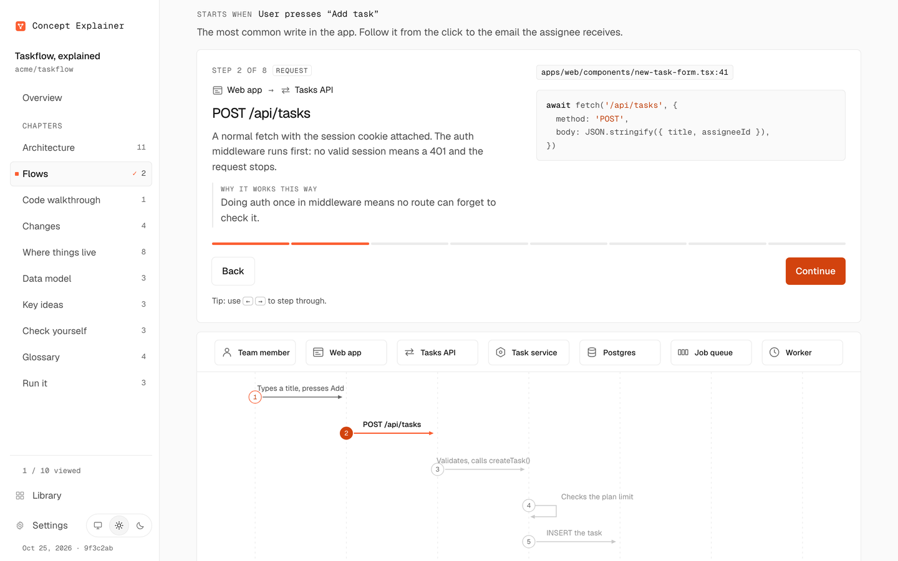
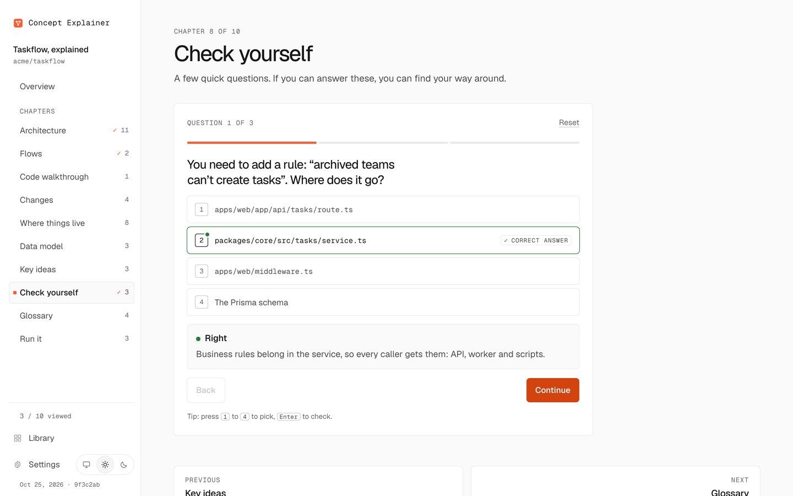
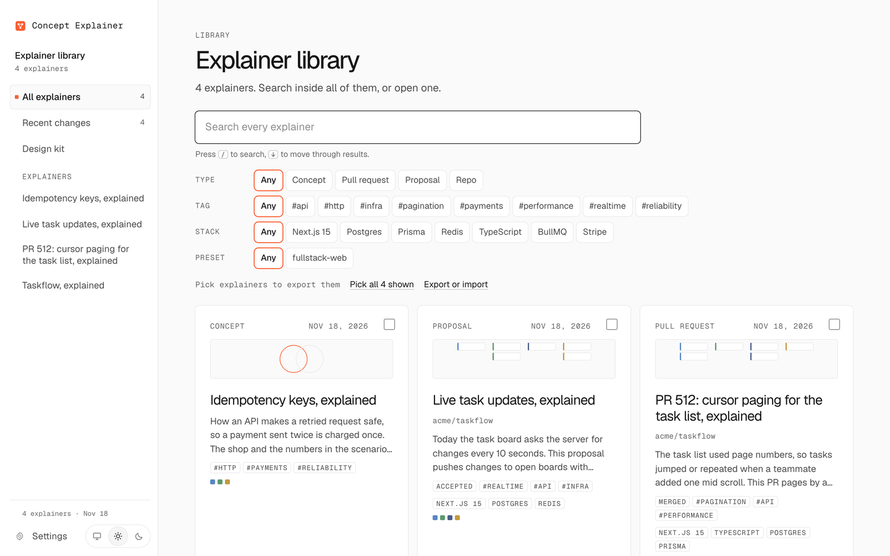

<p align="center">
  
</p>

<p align="center">
  <b>Tell your coding agent what to explain. Get one interactive page that teaches it.</b>
</p>

<p align="center">
  <a href="https://github.com/cyruspastelero/concept-explainer/actions/workflows/ci.yml"></a>
  <a href="LICENSE"></a>
  
  
</p>

<p align="center">
  <a href="https://cyruspastelero.github.io/concept-explainer/examples/taskflow.html"><b>Live demo</b></a>
  &nbsp;·&nbsp;
  <a href="#quick-start"><b>Quick start</b></a>
  &nbsp;·&nbsp;
  <a href="#docs"><b>Docs</b></a>
</p>

<p align="center">
  <a href="https://cyruspastelero.github.io/concept-explainer/examples/taskflow.html"></a>
</p>

An agent skill that turns a repo, a PR, a proposal, a migration, an incident or a concept into one
page: diagrams first, ideas broken into parts, every claim cited. It works with Claude Code out of the
box, and with any agent that can read a skill file and run Node.

Twenty merge requests land in a day, many from coding agents. An RFC proposes a new queue. Last night's
outage has a ten page post-mortem. Nobody holds the whole picture, and reading every diff and doc does
not scale. Concept Explainer has your agent do the reading, then **teach** the result.

**How it works**

1. Ask your agent to explain something: a PR, a repo, an RFC, an idea.
2. It works out the type and shows you the time and cost per model. Nothing runs until you say go.
3. It reads the source, writes the explainer as data, and checks every cited file and line.
4. It builds one HTML page and files it in your searchable library.

- **Pictures first.** Architecture maps, request flows you step through, nine clickable diagram kinds
  and code walkthroughs. [More](docs/features.md)
- **Every claim cited.** Code claims link to `file:line`, and the build checks that the cited files
  exist. [More](docs/consistency.md)
- **Cost shown up front.** An estimate before any work, or a budget so it never has to ask.
  [More](docs/cost.md)
- **Same look every time.** Agents write data only. The design is fixed and guarded by tests.
  [More](docs/consistency.md)

## Sample pages

Built with the skill and committed in [`examples/`](examples). Click one to open it live.

| Repo: Taskflow | Pull request: cursor paging |
| --- | --- |
| [](https://cyruspastelero.github.io/concept-explainer/examples/taskflow.html) | [](https://cyruspastelero.github.io/concept-explainer/examples/pr-cursor-paging.html) |
| The map, request flows, the data model and what changed. | The problem, the diff file by file, risks and rollout. |

| Proposal: live updates | Concept: idempotency keys |
| --- | --- |
| [](https://cyruspastelero.github.io/concept-explainer/examples/proposal-live-updates.html) | [](https://cyruspastelero.github.io/concept-explainer/examples/concept-idempotency-keys.html) |
| Options side by side, the chosen one marked. | The idea in parts, a diagram each, and a quiz. |

Every diagram kind is on one page: [the kit](https://cyruspastelero.github.io/concept-explainer/examples/gallery.html).

## Quick start

**The fast way: paste this into your coding agent** and it sets everything up:

```text
Set up Concept Explainer for me.
1. Check that Node.js 18.3 or newer and git are installed. Ask me before installing anything.
2. Clone https://github.com/cyruspastelero/concept-explainer.git into ~/concept-explainer.
3. If you are Claude Code, run: node ~/concept-explainer/bin/concept-explainer.mjs install
   Otherwise, add ~/concept-explainer/SKILL.md to your skills or instructions.
4. Tell me if I need to restart you, then suggest a first thing to explain in this folder.
```

**Or by hand:**

```sh
git clone https://github.com/cyruspastelero/concept-explainer.git ~/concept-explainer
node ~/concept-explainer/bin/concept-explainer.mjs install
```

`install` links the skill and a short rule into `~/.claude` ([what it changes](docs/commands.md#what-install-does)).
Other agents: point them at [`SKILL.md`](SKILL.md) in the clone.

**Then ask your agent:**

> Explain PR 512 for a reviewer.
>
> Explain how idempotency keys work, with diagrams.
>
> Explain this repo for a new engineer. Trace sign in and checkout end to end.

**No agent?** The CLI runs on its own: `npx github:cyruspastelero/concept-explainer estimate ./my-repo`.
See [commands](docs/commands.md).

## What it can explain

| Type | What you see | Example |
| --- | --- | --- |
| `repo` | The architecture map, step-through request flows, the data model, what changed and why | [Taskflow](https://cyruspastelero.github.io/concept-explainer/examples/taskflow.html) |
| `pr` | The problem, the diff file by file, the parts that move on the map, risks, rollout | [Cursor paging](https://cyruspastelero.github.io/concept-explainer/examples/pr-cursor-paging.html) |
| `change` | What one commit or range moved and why, and what could break | |
| `proposal` | Problem and goals, options side by side with the chosen one marked, rollout | [Live updates](https://cyruspastelero.github.io/concept-explainer/examples/proposal-live-updates.html) |
| `migration` | Before and after flows, the steps to get there, risks during the move | |
| `incident` | A timeline from the record, how the failure flowed, causes, follow ups | |
| `concept` | The idea in 2 to 6 parts, a diagram for each, a worked case, a quiz | [Idempotency keys](https://cyruspastelero.github.io/concept-explainer/examples/concept-idempotency-keys.html) |

Each type's chapters: [`references/types.md`](references/types.md).

## What you get

- **One page per explainer.** A single HTML file that works offline. Commit it, attach it to a PR or
  host it anywhere. Clean (the default) and Playful styles, light and dark.
- **Links to any view.** Send someone straight to a part, a step, a diff file, a diagram part or a
  line of a walkthrough.
- **A library of everything you build.** Search across every explainer, down to a single step, and
  open the exact view. Optional Dock app. [More](docs/library.md)
- **Updates, not rewrites.** The data lives in `.explainer/explainer.json`. The agent updates it and
  rebuilds when the code moves on.

<p align="center">
  
</p>

## Local and safe

- Your library lives in a private folder on your disk (`~/.concept-explainer`). No account, no
  telemetry.
- Pages make no network requests. Fonts are self-hosted and each page has a strict Content Security
  Policy.
- Repo, PR and doc text is treated as evidence, never as instructions. The scanner reads env var names,
  never values, and never opens `.env`.
- `library serve` listens on your own machine only and needs a token for every call.

Your coding agent still talks to its own AI provider. Details and reporting: [SECURITY.md](SECURITY.md).

## Dependencies

No npm packages. The whole thing runs on Node and a browser.

| You need | For |
| --- | --- |
| Node.js 18.3+ | The CLI: scan, validate, build, library |
| git | Diffs, change history and PR explainers |
| A coding agent (Claude Code, Codex, Cursor, Gemini CLI ...) | Reading the source and writing the explainer |
| A browser | Reading the pages |

## Docs

| Page | Read it for |
| --- | --- |
| [What a page looks like](docs/features.md) | Diagrams, walkthroughs, links to any view, styles and Settings |
| [Commands](docs/commands.md) | Every CLI command and what `install` changes |
| [The library](docs/library.md) | Search, serve, the Dock app, sharing bundles |
| [Cost and estimates](docs/cost.md) | Price per run and model |
| [Consistency](docs/consistency.md) | The data contract and the tests that guard the look |
| [`references/`](references/) | The agent-facing specs: data schema, types, visuals, explaining method |
| [Changelog](CHANGELOG.md) | What changed in each release |

## Coming next

- **It learns what to explain better.** Readers mark sections "Explain more" or "Too basic", and the
  next update deepens what they asked about (branch `feat/learning-loop`).

> Concept Explainer was called Repo Explainer. The `repo-explainer` command still works as an alias,
> and your library moves from `~/.repo-explainer` to `~/.concept-explainer` on the first run, without
> deleting anything.

## Credits

Type and greys from [Geist](https://vercel.com/geist). Lesson pacing inspired by
[Brilliant](https://brilliant.org), the Playful style by [Duolingo](https://www.duolingo.com)'s design
language, and explanation design by Bret Victor's
[Explorable Explanations](https://worrydream.com/ExplorableExplanations/), Red Blob Games and the C4
model.

Concept Explainer is independent and not affiliated with or endorsed by Vercel, Brilliant or Duolingo.
It includes none of their logos, mascots or illustrations. The icons and the mark are original.

## Contributing

Issues and pull requests are welcome. Read [CONTRIBUTING.md](CONTRIBUTING.md) and run `npm run check`
before opening a PR. Security reports: [SECURITY.md](SECURITY.md).

## License

MIT. See [LICENSE](LICENSE). The bundled fonts (Geist, Geist Mono, Nunito and JetBrains Mono) keep
their own SIL Open Font License; [NOTICE](NOTICE) lists them.
