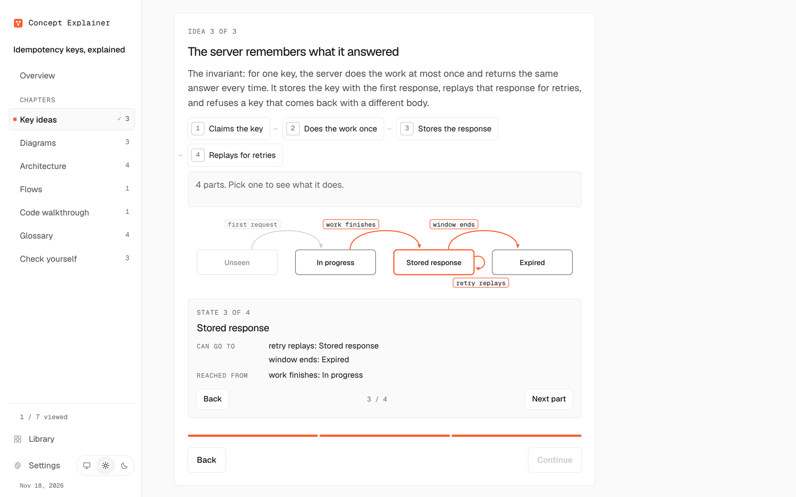
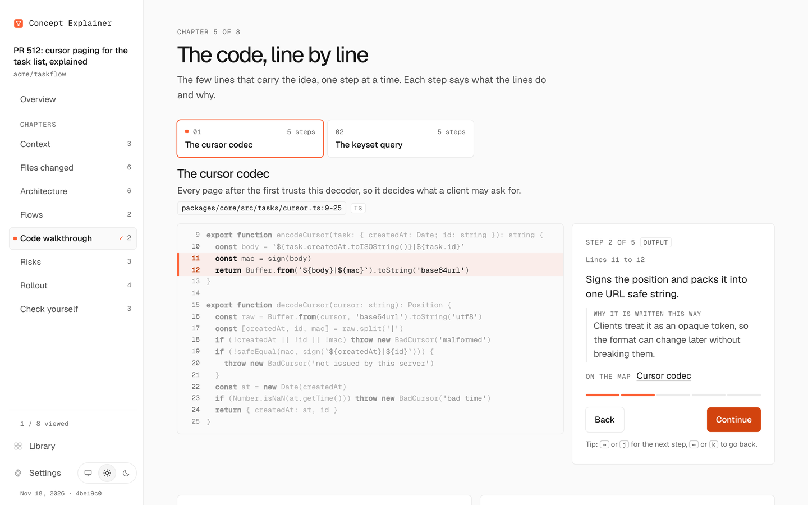
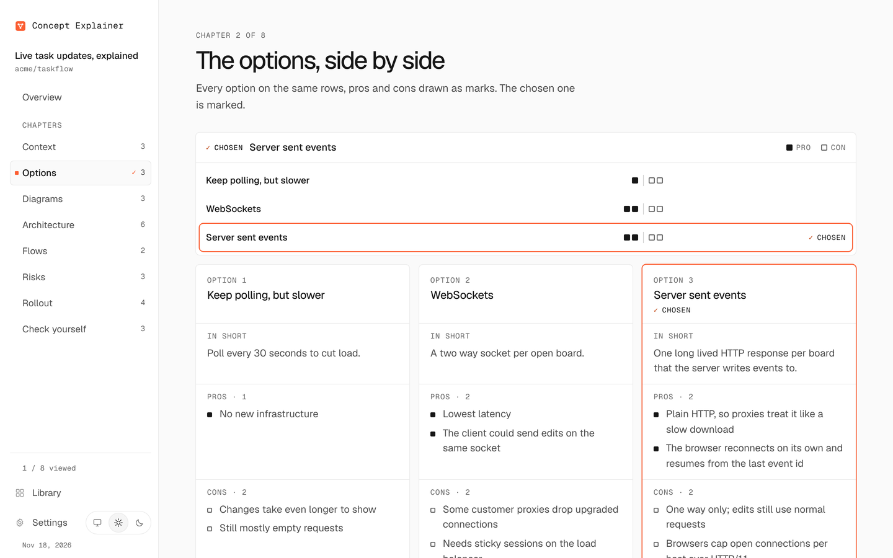
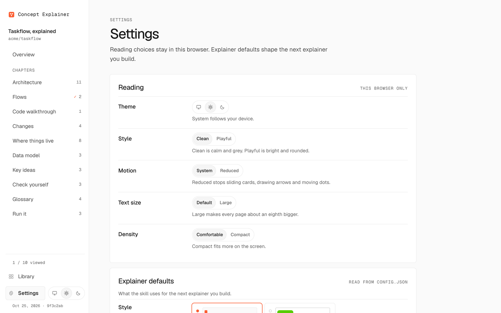

<p align="center">
  
</p>

<p align="center">
  <b>Explain anything technical as a guided, interactive picture.</b><br>
  An agent skill that turns a repo, a PR, a change, a proposal, a migration, an incident or a concept into one page: diagrams first, ideas broken into parts, every claim cited.
</p>

<p align="center">
  <a href="https://github.com/Cyvid7-Darus10/concept-explainer/actions/workflows/ci.yml"></a>
  <a href="LICENSE"></a>
  
  
</p>

<p align="center">
  <a href="https://cyvid7-darus10.github.io/concept-explainer/examples/taskflow.html"><b>Live demo</b></a>
  &nbsp;·&nbsp;
  <a href="#quick-start"><b>Quick start</b></a>
  &nbsp;·&nbsp;
  <a href="#what-it-can-explain"><b>Types</b></a>
  &nbsp;·&nbsp;
  <a href="#the-library"><b>Library</b></a>
  &nbsp;·&nbsp;
  <a href="#what-a-run-costs"><b>Cost</b></a>
  &nbsp;·&nbsp;
  <a href="#security"><b>Security</b></a>
</p>

<p align="center">
  <a href="https://cyvid7-darus10.github.io/concept-explainer/examples/taskflow.html"></a>
</p>

> Concept Explainer was called Repo Explainer. The `repo-explainer` command still works and prints a note, and your library moves from `~/.repo-explainer` to `~/.concept-explainer` on the first run, without deleting anything.

## Why

Understanding a repo used to mean reading it. A few people wrote the code, you knew who to ask, and the history told a story.

Picture a busy team today. Twenty merge requests land in a day, many from coding agents. An RFC proposes a new queue. Last night's outage has a ten page post-mortem. Nobody holds the whole picture:

- **What is new**, and **why** was it added?
- **How does it work now**, end to end?
- **What was decided**, against which options?
- **What actually happened**, in what order?

Reading every diff and doc does not scale. Concept Explainer has your agent do the reading, then **teach** the result like a good lesson: one idea at a time, a picture for each idea, and every claim linked to a real line of code or a real source.

## What it can explain

The agent works out what you gave it, then fills the same format. Your library can then filter by type.

| Type | Explains | What you see |
|---|---|---|
| `repo` | A whole codebase | The architecture map, step-through request flows, the data model, what changed and why |
| `pr` | One PR or MR | The problem, a file by file walkthrough of the diff, the parts that move on the map, risks, rollout |
| `change` | One commit or a short range | What moved and why, and what could break |
| `proposal` | An RFC, design doc or idea | Problem and goals, options side by side with the chosen one marked, before and after, rollout |
| `migration` | An upgrade or re-platform | Before and after flows, the options, the steps to get there, risks during the move |
| `incident` | A post-mortem | A timeline from the record, how the failure flowed, every contributing cause, follow ups |
| `concept` | An idea like OAuth or CRDTs | The idea broken into 2 to 6 parts, a diagram for each, a worked case, a quiz that tests transfer |

See one of each, built from the files in [`examples/`](examples/):

- [Taskflow, a repo](https://cyvid7-darus10.github.io/concept-explainer/examples/taskflow.html): the map, request flows, the data model and a code walkthrough.
- [Cursor paging, a PR](https://cyvid7-darus10.github.io/concept-explainer/examples/pr-cursor-paging.html): the diff file by file, the parts that moved, risks and rollout.
- [Live task updates, a proposal](https://cyvid7-darus10.github.io/concept-explainer/examples/proposal-live-updates.html): options side by side, before and after, the rollout.
- [Idempotency keys, a concept](https://cyvid7-darus10.github.io/concept-explainer/examples/concept-idempotency-keys.html): the idea in parts, a diagram for each, a transfer quiz.

## Show it, don't tell it

Every chapter is a picture first and text second.

- **Chapters draw themselves.** Options are a comparison grid. Risks sit in an impact grid. A rollout is a stepped track. A timeline is a time axis. A diff is a bar per file, linked to the map, where the parts that moved are marked.
- **A kit of nine diagrams** for everything else: `layers`, `cycle`, `state`, `compare`, `hierarchy`, `beforeAfter`, `quadrant`, `funnel` and `venn`. Data only, no drawing by hand. Every part is clickable and has its own detail.
- **Big ideas come in parts.** A concept splits into 2 to 6 parts you click through, each named by what it does, often with its own diagram.
- **Code walkthroughs.** When the idea lives in a few lines, the page walks through them one step at a time: which lines, what they do and why, then the takeaway. `concept-explainer snippet` pulls the exact lines from the repo, so nothing is retyped.

Under the pictures is a method for explaining to the root. Before it fills anything, the agent writes a six line root card: the problem, the mechanism, the invariant, what happens without it, the common misconception and the idea that makes the rest click. It picks each diagram by the question it answers and writes quiz questions that test transfer, not recall. See [`references/explaining.md`](references/explaining.md).

| | |
|---|---|
|  |  |
| **Diagrams.** Pick a part to see what it does. | **Code walkthrough.** The few lines that carry the idea, step by step. |
|  |  |
| **Decisions.** Every option on the same rows, the chosen one marked. | **Check yourself.** Feedback explains the tempting wrong answer too. |

## What you get

One self-contained HTML page per explainer, laid out as a dashboard.

- **An Overview first:** the summary, the counts, a card per chapter and where to start.
- **One view per chapter**, from a sidebar that marks where you are and how much you have viewed. On a phone, a Menu button opens the same list.
- **Flows you step through.** One hop at a time on a sequence diagram, each citing `file:line`, with a Continue button. Before and after flows sit side by side.
- **Every view has a link**, so you can send someone straight to a part, a step, a diff file, a diagram part or a line of a walkthrough: `#map/<node>`, `#flows/<flow>/<step>`, `#diff/<path>`, `#visuals/<diagram>/<part>`, `#code/<walkthrough>/<step>`. Back and forward work. The full list is in [`references/data-schema.md`](references/data-schema.md#deep-links).

| | |
|---|---|
|  |  |
| **Overview.** The summary, counts and where to start. | **Map.** Pick a part to see its files, neighbours and flows. |
|  |  |
| **Flows.** One hop at a time, with the code that does it. | **Settings.** Reading choices, explainer defaults and Share. |

### Looks and Settings

- **Two styles.** **Clean** is the default: Geist type and greys with one orange accent. **Playful** has brighter colors and rounder, pressable buttons, inspired by [Duolingo](https://www.duolingo.com)'s design language (not affiliated or endorsed). Pick the starting style with `--style`, or set the default with `concept-explainer config set style playful`.
- **Light, dark or system theme**, from a small menu by the gear or with **Shift+D**.
- **Settings** (`#settings`) has three groups:
  - **Reading**, kept in this browser: theme, style, motion, text size and density.
  - **Explainer defaults**, which steer the agent: audience, depth, language, preferred visuals, chapters per type, quiz and analogies, the model for estimates, a budget, whether to confirm before starting, and up to 2,000 characters of your own instructions.
  - **Share:** export this explainer as a bundle, or save the page as one file.

## Estimate before starting

Before any work, the agent shows how long a run will take and what it will cost, and waits for your go-ahead:

```
$ concept-explainer estimate --type pr
Estimate for a pr explainer: assumed 300 changed lines in 10 files (no --base given)

Model       Tokens in  Tokens out  Cost                Time
Fable 5.2   990K       12K         $0.89 to $1.79      8 to 18 min
Opus 5.5    990K       12K         $0.52 to $1.03      6 to 14 min
Sonnet 5.5  990K       12K         $0.26 to $0.52      4 to 10 min
Haiku 5.5   990K       12K         $0.016 to $0.033    2 to 6 min

Recommended: Sonnet 5.5. A good balance of care and cost for a job this size.
```

It sizes the input by type: source files for a repo, changed lines for a PR (`--base`), words for a doc (`--source`). Set `budgetUsd` in config and the agent skips the question whenever the estimate fits. How it works: [`references/estimate.md`](references/estimate.md).

## Quick start

### As an agent skill

```sh
git clone https://github.com/Cyvid7-Darus10/concept-explainer ~/side/concept-explainer
node ~/side/concept-explainer/bin/concept-explainer.mjs install
```

`install` links the skill into `~/.claude/skills/concept-explainer` and writes [`rules/concept-explainer.md`](rules/concept-explainer.md) to `~/.claude/rules/` (both under `$CLAUDE_CONFIG_DIR` when set), so every session builds explainers the same way and files them in your library. It is safe to run again. It never replaces a real folder or a rule you edited unless you pass `--force`, which keeps a backup in `~/.claude/backups/`.

Then ask your agent:

> Explain PR 512 for a reviewer.
>
> Explain how idempotency keys work, with diagrams.
>
> Explain this repo for a new engineer. Trace sign in and checkout end to end.

The agent follows [`SKILL.md`](SKILL.md): it identifies the type, estimates, waits for your go-ahead, finds the root, fills `explainer.json`, builds the page and files it in your library. Any agent that can read a skill file and run Node can use it.

### From the command line

```sh
npx github:Cyvid7-Darus10/concept-explainer estimate ./my-repo
npx github:Cyvid7-Darus10/concept-explainer init ./my-repo
npx github:Cyvid7-Darus10/concept-explainer init https://github.com/o/r/pull/7 --type pr --out pr.json
npx github:Cyvid7-Darus10/concept-explainer diff ./my-repo --base main --data pr.json --write
npx github:Cyvid7-Darus10/concept-explainer build pr.json --repo ./my-repo --strict --open
```

Needs Node 18.3 or newer. Nothing to install. The output is one HTML file you can commit, attach to a PR, or host anywhere, plus a copy in your library.

<details>
<summary><b>All commands</b></summary>

| Command | What it does |
|---|---|
| `estimate [input] [--type t]` | Time and cost per model before you start (`--base`, `--source`, `--json`) |
| `scan <repo>` | Stack, entry points, route handlers with `file:line`, data files, env var names (never values), scripts, a suggested preset |
| `init <repo> [--preset id]` | A starter repo explainer with `TODO`s to fill |
| `init [input] --type <type>` | A starter for pr, change, proposal, migration, incident or concept |
| `diff <repo> --base <ref>` | Draft `diff[]` and node statuses from git; summaries stay TODO |
| `snippet <repo> <path:start-end>` | Exact lines for a code walkthrough, as JSON |
| `changes <repo> [--data f --write]` | Draft change entries from git: human or agent, type, PR link, parts touched |
| `validate <file> [--repo dir] [--strict]` | Check references, shapes, lesson limits, writing style, and that cited files exist |
| `build <file> [--out f] [--repo dir] [--style s]` | Validate, render the page, file it in the library (`--no-library` skips that) |
| `library [list\|path\|add\|remove\|rebuild\|open\|style\|serve]` | Work with the library |
| `export [slug...] [--type t] [--tag t] [--out f]` | Share explainers as a data-only bundle |
| `import <file> [--dry-run] [--on-conflict mode]` | Add a bundle to your library |
| `config [get\|set\|reset] [--json]` | The explainer defaults the skill reads first |
| `install [--force]` | Link the skill and the library rule into `~/.claude` |
| `presets` | One preset per type, and stack presets for repos |
| `patterns [id]` | Reusable flow shapes: auth, webhook, async job, cache, and more |
| `gallery` | The kit page |
| `assets` | Logo and icon SVGs |

The old `repo-explainer` command is an alias that prints a deprecation note.

</details>

## The library

Explainers pile up across repos, PRs and sessions. So every build also lands in one local folder, `~/.concept-explainer` (or `$CONCEPT_EXPLAINER_HOME`), and its `index.html` puts them all in one place.

- **Search everything:** parts, flows, single steps, diff files, options, risks, timeline events, diagrams, walkthroughs, quiz questions, terms and folders across every explainer. Each result opens the exact view.
- **Browse and filter** by type, tag and stack, with a small drawing of each explainer on its card.
- **The kit** sits beside it, one click away.

```sh
concept-explainer build .explainer/explainer.json --repo .   # builds, then files it
concept-explainer library                                    # list what is in it
concept-explainer library open                               # open the hub
concept-explainer library serve                              # serve it on 127.0.0.1 so Settings can save
```

The hub is one HTML file that works offline from `file://`. The source of each explainer stays where it was made; the library keeps a copy and the built page.


**`library serve`.** From `file://`, a page cannot write, so Settings shows your values and the `config set` command to copy. Run `library serve` and Settings saves directly, and Share can export and import without the terminal. It binds to 127.0.0.1 only, uses a fresh token per run and serves only pages and fonts, never your library's data.

### An app on your Dock

No Electron, no install of a browser engine. The library can open like an app:

```sh
concept-explainer install --launcher    # macOS app, Linux menu entry or Windows Start Menu shortcut
```

Clicking it starts the library server on `127.0.0.1:4747` (if it is not already running), pairs your browser and opens the hub. In Chrome or Edge you can then install it as an app, and Safari can add it to the Dock; it keeps working offline for reading. The server stops itself after 30 idle minutes, and `uninstall --launcher` removes exactly what install wrote. Every explainer is still one HTML file you can share. How it works: [`references/launcher.md`](references/launcher.md).

### Share

Send one explainer, a topic or the whole library to someone else, who imports it into their own library.

```sh
concept-explainer export --type pr --tag payments --out payments.explainers.json
concept-explainer import payments.explainers.json --dry-run    # see what would happen
concept-explainer import payments.explainers.json              # rename on conflict by default
```

A bundle holds explainer data only: no pages, no scripts, no settings, no local paths. The importer checks it as untrusted input and rebuilds the pages with its own template. Layout, manifest, search index and the serve API: [`references/library.md`](references/library.md).

## What a run costs

The agent does the costly part: reading and writing the explainer. Estimated cost **per run** at a typical size, from [Claude API prices](https://claude.com/platform/api) checked November 18, 2026.

| Run | Fable 5.2 | Opus 5.5 | Sonnet 5.5 | Haiku 5.5 |
|---|---|---|---|---|
| Small repo (under 300 source files) | $0.96 to $1.92 | $0.55 to $1.11 | $0.28 to $0.55 | $0.018 to $0.035 |
| Medium repo (300 to 2,000 files) | $2.19 to $4.38 | $1.36 to $2.73 | $0.68 to $1.36 | $0.24 to $0.48 |
| Large repo (over 2,000 files) | $5.70 to $11.40 | $3.75 to $7.50 | $1.88 to $3.75 | $0.69 to $1.39 |
| PR (300 changed lines, 10 files) | $0.89 to $1.79 | $0.52 to $1.03 | $0.26 to $0.52 | $0.016 to $0.033 |
| Concept (3,000 words of sources) | $0.62 to $1.24 | $0.33 to $0.66 | $0.17 to $0.33 | $0.009 to $0.018 |

- **Sonnet 5.5** is a good default. A medium repo takes it about 8 to 19 agent minutes.
- **Opus 5.5** pays off on large or unfamiliar systems.
- **Haiku 5.5** suits small changes and a daily "what changed" refresh.

These are estimates, not quotes. They assume most repeated context comes from the prompt cache. Run `concept-explainer estimate` for your input. On a Claude subscription, usage counts against your plan instead.

## Built to stay consistent

Agents only write data. The design, components, diagrams, icons and motion are fixed and tested, so every explainer looks the same and readers learn it once.

- **One data contract**, checked on every build. See [`references/data-schema.md`](references/data-schema.md), [`references/types.md`](references/types.md) and [`references/visuals.md`](references/visuals.md).
- **Presets per type** and **flow patterns**, so agents start from a proven shape.
- **Explaining rules:** root card first, diagrams picked by the question they answer, captions that state the takeaway, analogies that say where they break. Some are enforced as warnings.
- **Writing rules:** gist first, short sentences, no filler.
- **Design guardrail tests** fail CI on blurred shadows, gradients, colors outside the tokens, stray radii, other fonts or `innerHTML`. The look is documented in [`references/design-system.md`](references/design-system.md).
- **Truthfulness:** code claims cite real files and `--repo` checks they exist. Proposals never show planned parts as built, incident times come from the record, and reasons come from PRs, commits and docs, never made up.

## Security

- **Zero npm dependencies.** The CLI and the pages run on Node and the browser alone.
- **Local only.** Your library lives in a private folder on your machine (`0700`). Pages make no request to anyone else: fonts are self-hosted, and each page carries a Content Security Policy that allows only its own code.
- **`library serve`** binds to 127.0.0.1, needs a per-run token for every API call, checks Host and Origin, and never serves your library's data or settings.
- **Content is data.** Text from repos, PRs, docs and imported bundles is evidence, never instructions: the skill does not follow instructions it finds there or run commands from them, and the CLI rejects hidden control characters. Git runs with the repo's own hooks, diff drivers and signature programs turned off.
- **Secrets stay out.** The scanner reads env var **names** from example files only and never opens `.env`.

Details and how to report a vulnerability: [SECURITY.md](SECURITY.md).

## Coming next

- **An app on your Dock:** a launcher that starts the library server and opens it as an installable app (branch `feat/app-launcher`).
- **It learns what to explain better:** readers mark sections "Explain more" or "Too basic", and the next update deepens what they asked about (branch `feat/learning-loop`).

## Credits

- **Type and greys** come from [Geist](https://vercel.com/geist), the Vercel design system.
- **Lesson pacing** is inspired by [Brilliant](https://brilliant.org): one idea per step, with a Continue button.
- **The Playful style** is inspired by [Duolingo](https://www.duolingo.com)'s design language.
- **Explanation design** draws on Bret Victor's [Explorable Explanations](https://worrydream.com/ExplorableExplanations/), Red Blob Games, the C4 model, and the research collected in [`references/explaining.md`](references/explaining.md).

Concept Explainer is independent and not affiliated with or endorsed by Vercel, Brilliant or Duolingo. It includes none of their logos, mascots or illustrations. Type is [Geist and Geist Mono](https://vercel.com/font), self-hosted under the SIL Open Font License (`fonts/OFL.txt`). The icons and the mark are original.

## Contributing

Issues and pull requests are welcome. Read [CONTRIBUTING.md](CONTRIBUTING.md) and run `npm run check` before opening a PR.

## License

[Apache License 2.0](LICENSE). If you use or adapt this project, keep the [NOTICE](NOTICE) file, which credits Cyrus David Pastelero, as the license requires.
