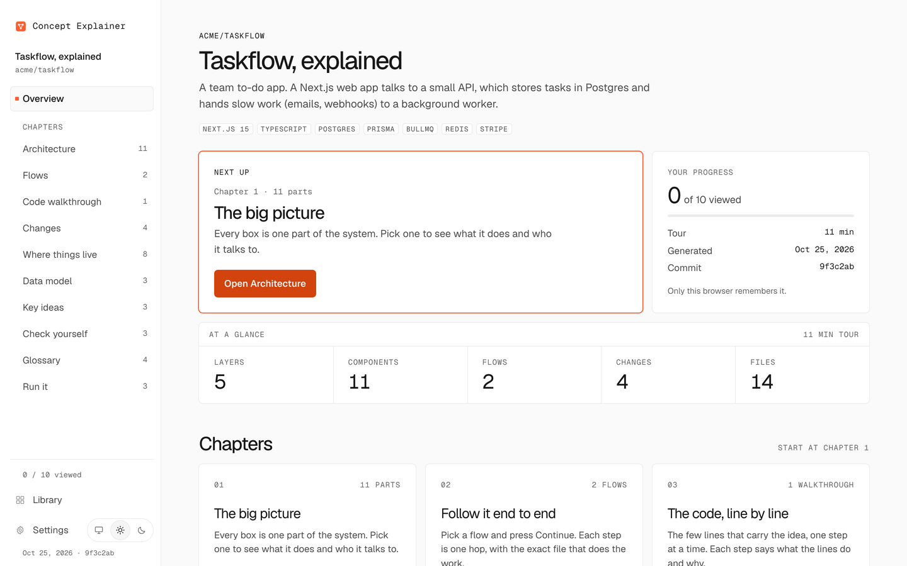
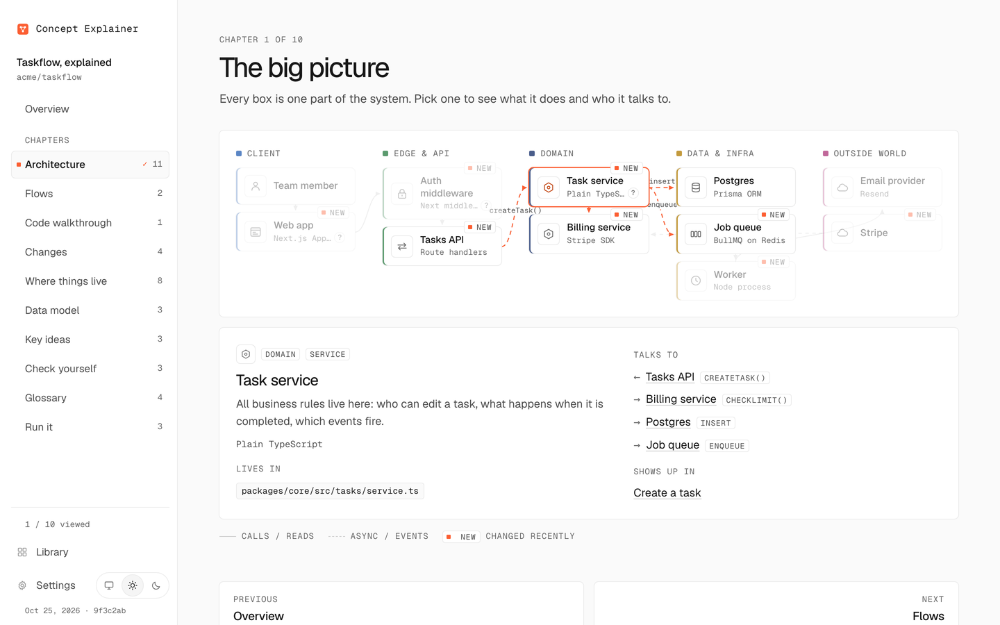
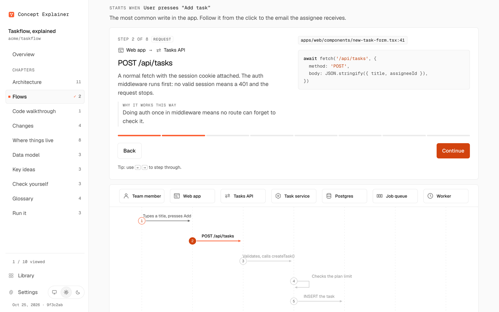
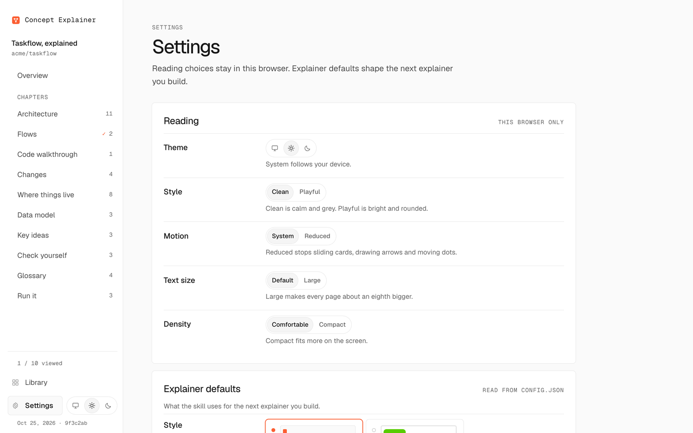
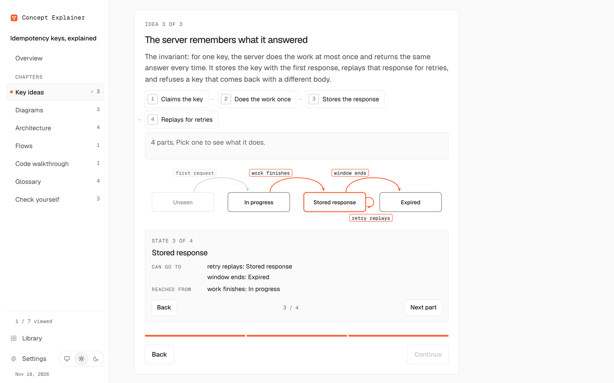
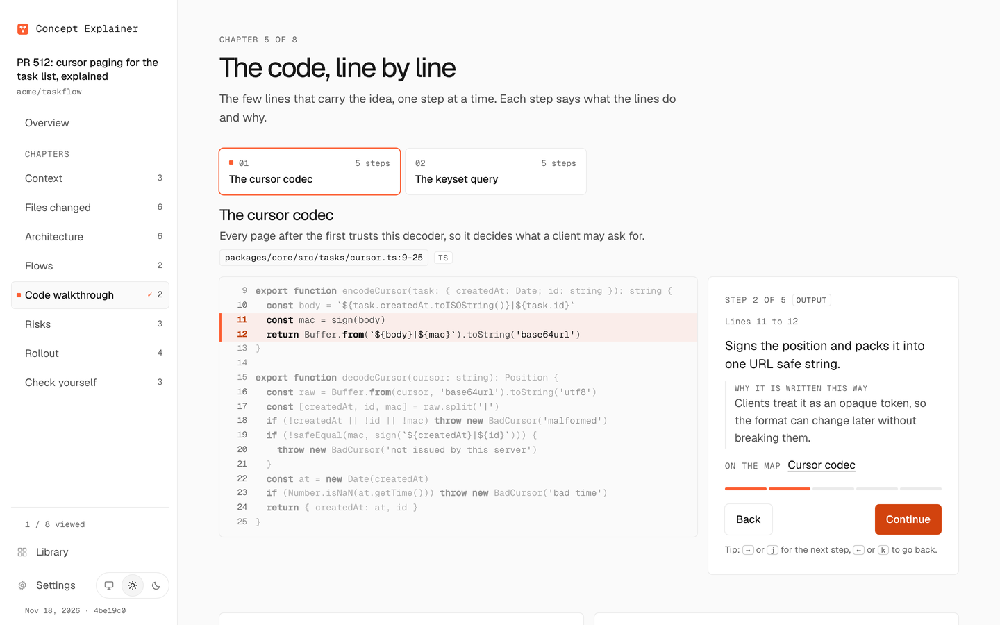
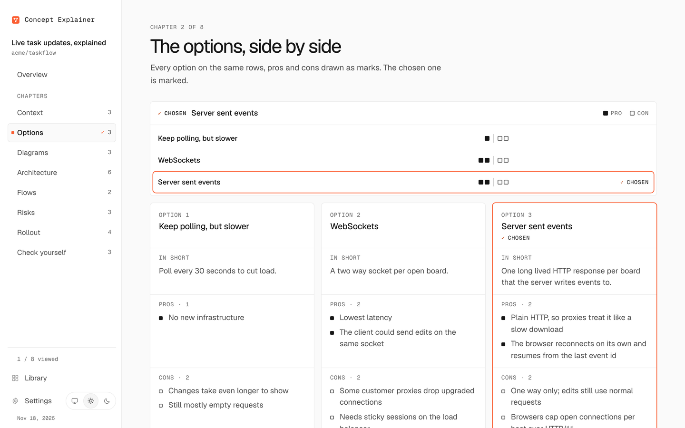
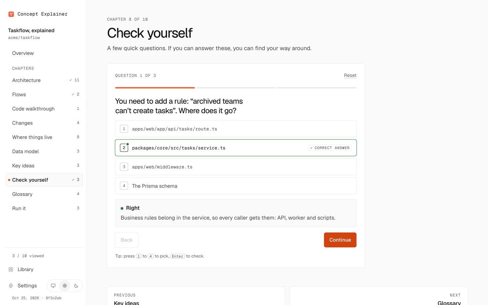

# What a page looks like

Every explainer is one self-contained HTML page, laid out as a dashboard. Pictures first, text second.

[Back to the README](../README.md)

## Contents

- [The page](#the-page)
- [Diagrams and walkthroughs](#diagrams-and-walkthroughs)
- [The method underneath](#the-method-underneath)
- [Links to any view](#links-to-any-view)
- [Looks and Settings](#looks-and-settings)

## The page

- **An Overview first:** the summary, the counts, a card per chapter and where to start.
- **One view per chapter**, from a sidebar that marks where you are and how much you have viewed. On a phone, a Menu button opens the same list.
- **Flows you step through.** One hop at a time on a sequence diagram, each citing `file:line`, with a Continue button. Before and after flows sit side by side.

| | |
|---|---|
|  |  |
| **Overview.** The summary, counts and where to start. | **Map.** Pick a part to see its files, neighbours and flows. |
|  |  |
| **Flows.** One hop at a time, with the code that does it. | **Settings.** Reading choices, explainer defaults and Share. |

## Diagrams and walkthroughs

- **Chapters draw themselves.** Options are a comparison grid. Risks sit in an impact grid. A rollout is a stepped track. A timeline is a time axis. A diff is a bar per file, linked to the map, where the parts that moved are marked.
- **A kit of nine diagrams** for everything else: `layers`, `cycle`, `state`, `compare`, `hierarchy`, `beforeAfter`, `quadrant`, `funnel` and `venn`. Data only, no drawing by hand. Every part is clickable and has its own detail. Reference: [`references/visuals.md`](../references/visuals.md).
- **Big ideas come in parts.** A concept splits into 2 to 6 parts you click through, each named by what it does, often with its own diagram.
- **Code walkthroughs.** When the idea lives in a few lines, the page walks through them one step at a time: which lines, what they do and why, then the takeaway. `concept-explainer snippet` pulls the exact lines from the repo, so nothing is retyped. Reference: [`references/code-walkthrough.md`](../references/code-walkthrough.md).

| | |
|---|---|
|  |  |
| **Diagrams.** Pick a part to see what it does. | **Code walkthrough.** The few lines that carry the idea, step by step. |
|  |  |
| **Decisions.** Every option on the same rows, the chosen one marked. | **Check yourself.** Feedback explains the tempting wrong answer too. |

## The method underneath

Before it fills anything, the agent writes a six line root card: the problem, the mechanism, the invariant, what happens without it, the common misconception and the idea that makes the rest click. It picks each diagram by the question it answers and writes quiz questions that test transfer, not recall. Full method: [`references/explaining.md`](../references/explaining.md).

## Links to any view

Every view has a link, so you can send someone straight to a part, a step, a diff file, a diagram part or a line of a walkthrough. Back and forward work.

| Link | Opens |
|---|---|
| `#map/<node>` | A part on the map |
| `#flows/<flow>/<step>` | One step of a flow |
| `#diff/<path>` | One file of a diff |
| `#visuals/<diagram>/<part>` | One part of a diagram |
| `#code/<walkthrough>/<step>` | One step of a walkthrough |
| `#settings` | Settings |

The full list is in [`references/data-schema.md`](../references/data-schema.md#deep-links).

## Looks and Settings

- **Two styles.** **Clean** is the default: Geist type and greys with one orange accent. **Playful** has brighter colors and rounder, pressable buttons, inspired by [Duolingo](https://www.duolingo.com)'s design language (not affiliated or endorsed). Pick the starting style with `--style`, or set the default with `concept-explainer config set style playful`.
- **Light, dark or system theme**, from a small menu by the gear or with **Shift+D**.
- **Settings** has three groups:
  - **Reading**, kept in this browser: theme, style, motion, text size and density.
  - **Explainer defaults**, which steer the agent: audience, depth, language, preferred visuals, chapters per type, quiz and analogies, the model for estimates, a budget, whether to confirm before starting, and up to 2,000 characters of your own instructions.
  - **Share:** export this explainer as a bundle, or save the page as one file.

From `file://` a page cannot write, so Settings shows the `config set` command to copy. Run `concept-explainer library serve` and Settings saves directly. See [the library](library.md#serve).

The look is fixed and tested: [`references/design-system.md`](../references/design-system.md).
