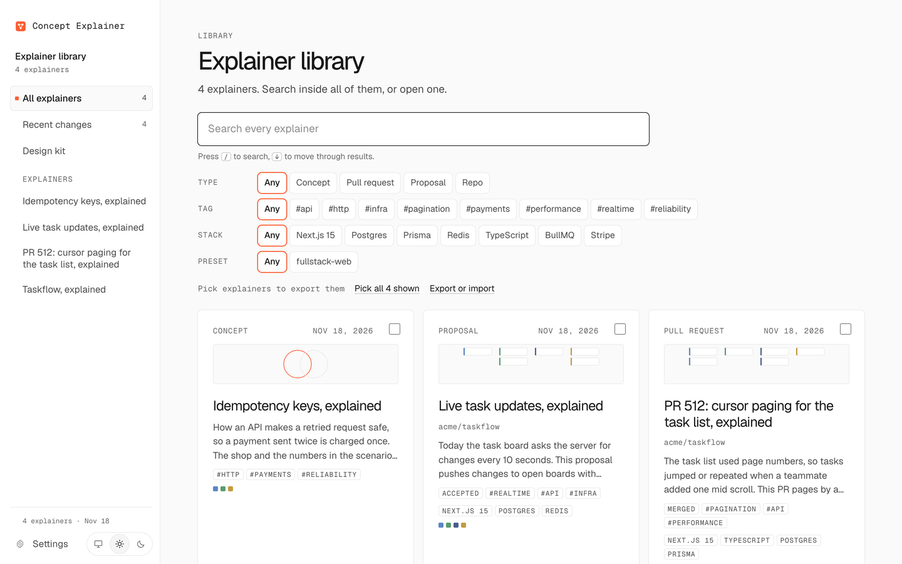

# The library

Every build also lands in one local folder, `~/.concept-explainer` (or `$CONCEPT_EXPLAINER_HOME`), and its `index.html` puts all your explainers in one place.

[Back to the README](../README.md)



## Contents

- [What it does](#what-it-does)
- [Commands](#commands)
- [Serve](#serve)
- [An app on your Dock](#an-app-on-your-dock)
- [Share](#share)

## What it does

- **Search everything:** parts, flows, single steps, diff files, options, risks, timeline events, diagrams, walkthroughs, quiz questions, terms and folders across every explainer. Each result opens the exact view.
- **Browse and filter** by type, tag and stack, with a small drawing of each explainer on its card.
- **The kit** sits beside it, one click away.

The hub is one HTML file that works offline from `file://`. The source of each explainer stays where it was made; the library keeps a copy and the built page.

## Commands

```sh
concept-explainer build .explainer/explainer.json --repo .   # builds, then files it
concept-explainer library                                    # list what is in it
concept-explainer library open                               # open the hub
concept-explainer library serve                              # serve it on 127.0.0.1 so Settings can save
```

## Serve

From `file://`, a page cannot write, so Settings shows your values and the `config set` command to copy. Run `library serve` and Settings saves directly, and Share can export and import without the terminal.

It binds to 127.0.0.1 only, uses a fresh token per run and serves only pages and fonts, never your library's data.

## An app on your Dock

No Electron, no browser engine to install. The library can open like an app:

```sh
concept-explainer install --launcher    # macOS app, Linux menu entry or Windows Start Menu shortcut
concept-explainer uninstall --launcher  # removes only the launcher files it made
```

Clicking it starts the library server if it is not already running, pairs your browser and opens the hub. If your port is taken, `library serve --new-port` picks another.

On a machine with other login accounts, install warns and turns off the installable app and offline cache; `--pwa` opts in. Why, and how the pairing works: [`references/launcher.md`](../references/launcher.md).

## Share

Send one explainer, a topic or the whole library to someone else, who imports it into their own library.

```sh
concept-explainer export --type pr --tag payments --out payments.explainers.json
concept-explainer import payments.explainers.json --dry-run    # see what would happen
concept-explainer import payments.explainers.json              # rename on conflict by default
```

A bundle holds explainer data only: no pages, no scripts, no settings, no local paths. The importer checks it as untrusted input and rebuilds the pages with its own template.

Layout, manifest, search index and the serve API: [`references/library.md`](../references/library.md).
